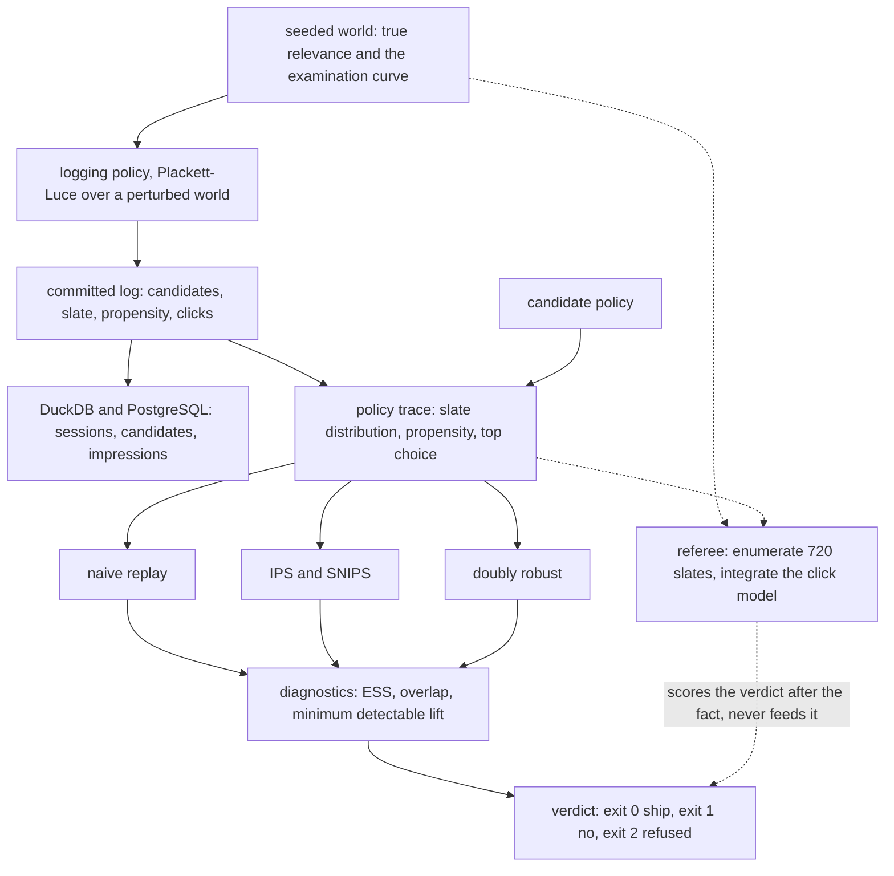
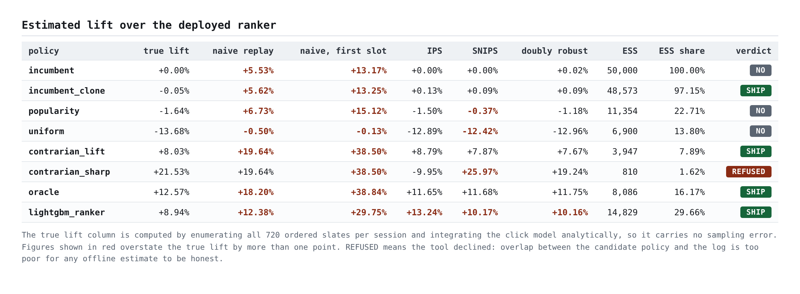
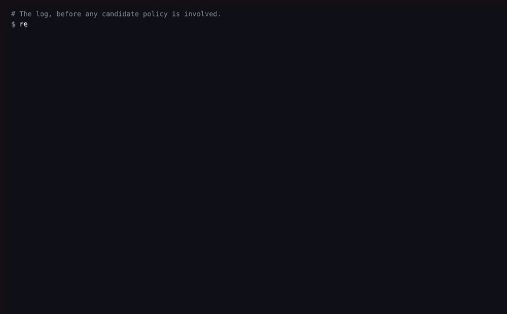

# replay-gap

[](https://github.com/GITHUB_USERNAME/replay-gap/actions/workflows/ci.yml)
[](pyproject.toml)
[](LICENSE)
[](Makefile)

**Offline ranker evaluation that reports when it cannot answer.** The log was produced by the
ranker that is already deployed, so replaying a candidate against it cannot separate a genuinely
better model from one that merely agrees with production more often. This measures that gap
against an exact referee, prices the correction, and refuses when the log cannot support an
answer at all.

Replaying the deployed ranker against its own log says it is **+5.53% better than itself.**

## Four questions this answers that a replay cannot

A replay keeps the sessions where production happened to serve the candidate's own first choice
and averages their reward. That selection rule is the problem, and it makes four questions
structurally unanswerable:

1. **Is this candidate better, or does it just agree with production more?** The sessions a
   replay keeps are selected on agreement with the logging policy, and agreement with the
   logging policy is itself correlated with reward.
2. **How much of this fifty thousand session log is left after correcting for that?** For some
   candidates, under two percent of it.
3. **Does serving the same model greedily change the answer?** It changes the truth by sixteen
   points. It changes the replay by nothing at all.
4. **Is this log able to answer at all?** Sometimes it is not, and the tool exits 2 rather than
   printing a number.

## The uncomfortable numbers, first

- **Replaying the deployed ranker against its own log reports +5.53%.** Its true lift over
  itself is zero, because it is itself. The entire figure is the estimator's bias, with no model
  quality mixed in. It was computed on 17,187 sessions, 34.4% of the log.
- **Over 180 candidate rankers, naive replay picks the wrong winner in 27.1% of decisive
  cases.** The worst one: a ranker whose true lift is -10.80% read as +6.24%, a gap of 17.04%.
  SNIPS, on the same scenarios, gets the sign wrong in 1.8%.
- **The correction is not a fix either.** SNIPS calls a policy that is actually -0.05% a ship at
  +0.09%, at 97% of the log still effective. The log cannot resolve a question that fine, and
  the tool says so.
- **The diagnostic that decides whether to trust an estimate can move the wrong way.** Corrupt
  the logged propensities and the corrected estimate decays while effective sample size
  *climbs*, in all 3 of the crossovers measured. That is a real limit of this design, not a bug
  in it.

372 tests at 100% line coverage, one seed, offline after install. 371 of them run anywhere; the
one that does not is the PostgreSQL parity test that needs a live server, and the rest of that
module checks the dialect contract without one.
Every figure in this document is re-measured by CI and checked against the sentence around it,
so a stale number fails the build rather than sitting here looking plausible.

## Quickstart

Prerequisites: Python 3.11 or later. Nothing else: no Docker, no API key, no credentials. The
install needs a package index; everything after it runs offline.

```bash
git clone https://github.com/GITHUB_USERNAME/replay-gap.git
cd replay-gap
python -m pip install -e ".[dev]"

# The headline number: the deployed ranker, replayed against the log it produced.
replay-gap evaluate incumbent --no-ranker

# Every policy, every estimator, against the exact referee.
replay-gap compare

# Lint, the full suite, re-measure every published figure, fail if the prose has drifted.
make verify
```

`make verify` is the command this document promises. It runs with no network and must pass from
a fresh clone.

## What is standard here, and what is not

The four estimators are textbook. Naive replay, inverse propensity scoring, its self normalised
form and the doubly robust estimator are all decades old and are implemented here the way the
literature describes them. What this repository builds is the apparatus around them: a referee
that is exact rather than another estimate, a refusal path with an exit code of its own, and a
receipts mechanism that re-measures every published figure and fails the build when a document
has drifted from it.

## The headline, in full

```
policy                  incumbent
sessions in the log     50,000
logged mean reward      1.07396

naive replay lift       +5.53%   (on 17,187 matched sessions, 34.4% of the log)
corrected lift (SNIPS)  +0.00%   95% interval [+0.00%, +0.00%]
true lift (referee)     +0.00%

effective sample size   50,000 of 50,000 (100.00%)
largest single weight   0.002% of the total mass
weights hitting the cap 0.000% of sessions
minimum detectable lift +0.00%

verdict                 NO (exit code 1)
reason                  corrected lift of +0.00% is not distinguishable from zero
```

The incumbent is the deployed ranker re-evaluated as though it were a candidate. Its true lift
over itself is exactly zero, not approximately zero, because the policy and the referee are the
same object. So the +5.53% is pure estimator bias, and it is the cleanest possible measurement
of the effect: no model quality, no noise, no argument about what the true value should have
been.

Why the corrected estimate is exactly +0.00% and its interval has zero width: the importance
weights are exactly one, so every bootstrap resample returns exactly the logged mean. That is
correct and it is also the reason the incumbent is excluded from the resolution table below.

## The gap, measured over a sampled population of rankers

180 candidate rankers drawn uniformly over the three way simplex of true relevance, the
incumbent's opinion, and an arbitrary wrong direction, each evaluated against the same log.

| measure | naive replay | SNIPS |
| --- | ---: | ---: |
| picks the wrong winner | in 45 of 166 decisive cases | 3 |
| sign disagreement rate | 27.1% of decisive cases | SNIPS 1.8% |
| mean signed error | +5.04% | +0.33% |
| mean absolute error | 5.06% | 1.21% |

Naive replay came in above the truth in 96% of scenarios. That one sidedness was not the
expected result. The prediction was a symmetric failure, flattering a copycat and punishing a
contrarian, and the measurement disagreed: there is no population of sessions that drags a
divergent policy's estimate down, because those sessions were discarded rather than down
weighted.

**Worst case a team would have shipped:** a ranker worth -10.80% to the business, read as
+6.24%.

## What a replay cannot see at all

Two policies. Identical rankings, to the last tie break. The only difference is the temperature
they are served at, which is a serving decision nobody writes a design document about.

| policy | true lift | naive replay says |
| --- | ---: | ---: |
| oracle, served stochastically | +12.21% | +16.84% |
| oracle, served greedily | +28.59% | +16.84% |

Their true values differ by 16.39%. The replay returns the same number for both, to every digit,
because it reads the first slot of the sessions where that slot already matched, and serving
temperature reaches neither of those.

## What the correction costs: the log evaporates

Correcting the bias is importance weighting, and importance weighting spends sample size. As a
candidate moves away from the policy that produced the log, the number of sessions genuinely
informing the estimate collapses:

| toward true relevance | true lift | naive says | SNIPS says | effective sessions | largest weight |
| ---: | ---: | ---: | ---: | ---: | ---: |
| 0% | +0.00% | +5.53% | +0.00% | 50,000 | 1 |
| 25% | +4.84% | +8.23% | +4.87% | 42,160 | 7 |
| 50% | +9.17% | +11.81% | +9.05% | 23,223 | 36 |
| 75% | +11.83% | +15.55% | +11.24% | 12,271 | 116 |
| 100% | +12.57% | +18.20% | +11.68% | 8,086 | 311 |

The log falls to 16.17% of its nominal size, a factor of 6, for a strictly better model served
exactly as the old one was. Naive replay still reports +18.20% at the end of that sweep, where
the truth is +12.57%, and nothing in its output records that five sixths of the evidence has
gone.

Add a serving change, and a model that leans against production rather than merely improving on
it, and the same sweep ends at 1.62%, below the floor, where the tool refuses.

## What it costs against what it buys

| | what it costs | what it buys |
| --- | --- | --- |
| Correcting with importance weights | Effective sample size, by up to a factor of 60 | The sign is right in 1.8% wrong rather than 27.1% |
| Capping the weights | Bias towards the logged behaviour, on exactly the sessions where the candidate disagreed most | A variance that does not depend on the single largest weight |
| Refusing below the overlap floor | Questions go unanswered that a replay would have answered | No confident number on a log that cannot support one |
| Self normalising rather than plain IPS | A small bias that does not vanish with sample size | An estimate bounded by the rewards that actually occurred |

## The refusal, which is the product

```
$ replay-gap evaluate contrarian_sharp --no-ranker

naive replay lift       +19.64%   (on 4,342 matched sessions, 8.7% of the log)
corrected lift (SNIPS)  +25.97%   95% interval [+20.40%, +30.93%]
true lift (referee)     +21.53%

effective sample size   810 of 50,000 (1.62%)
verdict                 REFUSED (exit code 2)
reason                  effective sample size is 1.62% of the log, below the 2.00% floor.
                        Remedy: run an online experiment, or collect a log under a policy
                        that explores the actions this candidate wants to take.
```

`contrarian_sharp` is the same ranker as `contrarian_lift`. Nothing about the model changed; it
is served greedily instead of stochastically, so a replay reports +19.64% for it, exactly what
it reports for the stochastic version. The fifty thousand session log is worth 810
sessions for that question.

Had the tool answered, SNIPS would have reported +25.97% where the true lift is +21.53%, and
plain IPS reports -9.95%, which is the wrong sign by thirty points. Exit code 2 exists so that a
caller can tell "the tool worked and the answer is no" from "the log cannot answer this".

## What the evidence cannot justify

Three claims this repository is careful not to make, each with the measurement that stops it.

**"Correcting the estimate makes it reliable."** It makes it less wrong. On the default policy
set the corrected estimator still calls a -0.05% policy a ship at +0.09%, at 97% of the log
effective. The log is not able to resolve a lift that small, which is a fact about the log
rather than about the estimator.

**"The effective sample size tells you when to trust the answer."** It tells you whether the
weights are concentrated. It cannot tell you whether they are the right weights. Corrupt the
propensities and the correction stops being worth having at a corruption factor of 3.0, and at
that point the effective sample size reads 12.3% of the log, which is healthy, and the tool
answers confidently and is wrong. It read lower on the uncorrupted log than it does there.

**"Fifty thousand sessions is enough to evaluate a ranker offline."** Enough for what. The
median minimum detectable lift across the policy set is a median of 2.09%, and for 5 of 6
policies it is above the one percent a team would typically ship on. The worst case needs about
2,871,969 sessions to resolve a one percent lift, fifty seven times this log.

## What this log could actually have resolved

Two sided at alpha 0.05, 80% power, derived from the bootstrap spread of the corrected estimate.

| policy | true lift | SNIPS says | smallest detectable | was it detected |
| --- | ---: | ---: | ---: | --- |
| incumbent | +0.00% | +0.00% | exact | not applicable |
| incumbent_clone | -0.05% | +0.09% | 0.15% | no |
| popularity | -1.64% | -0.37% | 1.62% | yes |
| uniform | -13.68% | -12.42% | 2.11% | yes |
| contrarian_lift | +8.03% | +7.87% | 3.07% | yes |
| contrarian_sharp | +21.53% | +25.97% | 7.58% | yes, and refused |
| oracle | +12.57% | +11.68% | 2.07% | yes |

Read the right hand column before the left: for the policy a team would most want an answer
about, this log cannot resolve anything below 7.58%, and the policy it does resolve best is the
one nobody needs an answer about.

The incumbent's row reads "exact" rather than zero: its weights are exactly one, so the spread
is genuinely zero and it is not a resolution anybody can use. It is excluded from the summary
above for that reason rather than published as a log that can detect any lift at all.

On a measured zero, which is the most common way a portfolio overclaims: nothing observed zero
times in 50,000 sessions is zero. It is below one in fifty thousand, and a claim about a rarer
event needs a bigger sample rather than a stronger sentence.

## Four estimators, over independent replicates

24 independent replicates, each a fresh world and a fresh log. Error is against the exact
referee.

| policy | true lift | naive RMSE | IPS RMSE | SNIPS RMSE | DR RMSE | lowest |
| --- | ---: | ---: | ---: | ---: | ---: | --- |
| popularity | -2.23% | 10.67% | 4.36% | 2.43% | 1.88% | DR |
| oracle | +12.21% | 4.86% | 4.96% | 1.94% | 1.73% | DR |
| oracle, greedily served | +28.59% | 11.87% | 15.38% | 3.78% | 4.44% | SNIPS |
| contrarian_lift | +7.64% | 11.33% | 15.06% | 3.22% | 2.19% | DR |
| contrarian_sharp | +21.18% | 3.05% | 54.71% | 7.61% | 3.13% | naive, and refused |

Three things in that table are worth saying out loud.

**For the popularity baseline, naive replay got the sign wrong on all 24 replicates.** Its true
lift is -2.23%, it is genuinely worse than production, and a replay recommended shipping it
every single time.

**The doubly robust estimator was expected to lose for the most divergent policy. It wins
there.** It loses for a policy served greedily, at 4.44% for the doubly robust estimator against
SNIPS at 3.78%, because its outcome model is fitted on the same confounded log and is
extrapolating onto slates production almost never served. That is published because it is what
the measurement says, not because it was the plan.

**Naive replay has the lowest error for `contrarian_sharp`.** That is the regime where the
effective sample size is 1.62% and the tool refuses to answer at all. It is an estimator landing
near the truth by accident in a case where nothing here should be trusted, and the right reading
is that the refusal is doing its job.

## The bugs the measurement found

**A first slot replay divided by the wrong baseline, reporting -38.02% for the incumbent.** The
first version compared a replay scored on first slot clicks against the log's mean *session*
reward. Two different units. It produced a confident, plausible looking -38.02% for a policy
that is the deployed ranker, which reads as a finding and is a units error. That figure is
re-measured by the receipts tooling rather than remembered, so this paragraph cannot quietly
become wrong about its own bug. The fix made every
estimator declare the baseline it is denominated in, as a pair of per session sums, and a test
now pins that pairing. The same refactor turned the bootstrap into one matrix product, which was
the reason the error was findable: the estimators were all in one place.

**A verdict badge that rendered invisibly.** In an earlier project a badge class and a table
cell class collided at equal CSS specificity, the later rule won, and the headline verdict
rendered in one colour on the same colour. The Python was right, the HTML was right, the tests
passed. Two checks now exist: a test asserting every class the markup uses has a rule in the
stylesheet, and a screenshot tool that reads the computed style back from a real browser,
because only a browser can see pixels.

**A referee four times slower than it needed to be.** Enumerating 720 slates per session
gathered 720 strided columns out of a (sessions, candidates) array. Transposing the working
layout turns the same gather into contiguous row copies, and measured four to one on a fifty
thousand session log. Collapsing the slate distribution onto positions had the same shape and
the same fix, as a matrix product rather than a scatter add. The referee runs on every policy in
every experiment, so this is the difference between a suite CI reruns and one it does not.

## Architecture



The important thing in that picture is the separation. The world holds true relevance; the log
holds only what a production log would. The estimators see the log and a policy trace, which
carries a slate distribution, a propensity and a first choice and nothing else. The referee sees
the world. They never share a path, so an estimator cannot reach true relevance by accident.



## Evidence



The report above was generated by `replay-gap compare` and captured by
`tools/capture_screenshots.py`, which frames by named heading rather than by pixel offset and
fails the run if the verdict badge is not legible against its background.



The recording is a replay, not a screen capture: every line of terminal text is real captured
stdout, and each segment is paced by that command's measured wall time.
[`docs/video/manifest.json`](docs/video/manifest.json) lists every command with its exit code
and duration.

## The fixture, and specifically its awkward cases

`fixtures/interactions/` holds a 50,000 session log and the world that produced it, both
regenerable from one seed. A test regenerates them and compares content hashes, so the committed
file cannot outlive the code that wrote it.

The policy set is chosen to contain the cases that break things, not the cases that demonstrate
them:

- **`incumbent`** is the deployed ranker as a candidate. True lift exactly zero, so any non zero
  estimate is pure bias.
- **`incumbent_clone`** is the incumbent plus a little noise. Its true lift is -0.05%, which is
  below what the log can resolve, and the corrected estimator calls it a ship. The honest
  failure case.
- **`contrarian_lift`** is genuinely better than production and agrees with it on the first slot
  in 8.7% of sessions. It separates "disagrees a lot" from "is worse", which is what a replay
  confuses.
- **`contrarian_sharp`** is the same ranker served greedily. It is the refusal case, and it is
  also the case where naive replay happens to be most accurate.
- **`popularity`** is a baseline a real team would ship. It is worse than production, and a
  replay recommends it every time.

## What this cannot establish

This section is the point, not a disclaimer. Full detail in
[ADR-005](docs/adr/ADR-005-what-this-repository-cannot-establish.md).

**The propensities here are exact, and in production they are not.** The logging policy is
Plackett-Luce by construction, so its propensities are a closed form. Real logs record them at
the wrong granularity, or before a reranking step, or reconstruct them from a checkpoint that
has moved. E5 corrupts them deliberately: the correction stops being worth having at a
corruption factor of 3.0, and the effective sample size at that point reads higher than on the
clean log, in all 3 crossovers. **No diagnostic here detects a propensity that is confidently
wrong**, and closing that needs an external signal such as a randomised serving holdout.

**The world is synthetic, and retrieval is deliberately unbiased.** In production the retrieval
stage is itself a policy trained on logged data, so the candidate set is confounded before the
ranker sees it. Every number here would be worse with a biased retriever, not better.

**Which claims transfer.** The deployed ranker overstating itself follows from the selection
rule rather than from the data, so the sign holds on any log; the magnitude does not. A replay's
blindness to serving temperature is structural and holds anywhere. The collapse rates, the
disagreement rate and the detectable lifts depend on how far the candidates sit from production,
so take them as evidence the effect is large, not as numbers to quote.

**One claim genuinely needs a real log:** whether a 2% effective sample size floor is the right
floor. It is calibrated against this world's weight distribution, which is why it is a
configuration value and not a constant.

**Declared rather than observed:** the examination curve, the candidate set size and slate
length, and the refusal thresholds.

**No absolute duration is published anywhere in this repository.** Durations go into the
experiment JSON for the record and never into a claim, because a published millisecond is a fact
about whichever machine ran it.

## Layout

```
config/default.yaml         every threshold and seed, nothing hardcoded in the source
fixtures/interactions/      the committed log, its world, and a manifest carrying its hash
sql/duckdb/                 six queries that execute on every verify
sql/postgres/               the same six for a server, run by an optional CI job
src/replay_gap/
  ranking.py                Plackett-Luce: sampling, exact propensities, exact policy values
  simulator/                the world, the deployed policy, the log, and the referee
  policies/                 candidates, including the two built to break a replay
  estimators/               naive, IPS, SNIPS, doubly robust, and the paired bootstrap
  diagnostics/              effective sample size, overlap, minimum detectable lift
  store/                    DuckDB execution and the dialect contract
  pipeline.py               evaluation, and the rule that turns a result into an exit code
  cli.py                    the command surface and the four exit codes
experiments/                E1 to E5, each writing JSON that nothing types by hand
tools/                      receipts, diagrams, screenshots, demo replay
docs/adr/                   five decisions, one of which is the boundary
```

## Exit codes

| code | meaning |
| --- | --- |
| 0 | Evaluated. The corrected lift is positive and the interval excludes zero. |
| 1 | Evaluated. The lift is not positive. The tool worked; the answer is no. |
| 2 | Refused. Overlap is too poor for any offline estimate to be honest. Run an experiment. |
| 3 | Tool error. Something in the tool failed, which is not the log being unable to answer. |

The distinction between 1 and 2 is the reason this repository exists. An evaluation tool with no
way to decline will always produce a number, and a number is what gets shipped on. A comparison
returns 2 if any policy in it was refused, even when another policy won, because the unanswered
question is the one somebody will otherwise ship on the strength of a replay.

## Make targets

```
make install      install the package and its development extras
make lint         ruff over src, tests, tools and experiments
make test         pytest with junit and coverage reports
make fixtures     regenerate the committed log from its seed
make experiments  run E1 to E5 and write docs/experiments/*.json
make receipts     re-measure every published figure and check it against the prose
make verify       lint + test + receipts. The command this README promises.
make evidence     regenerate the diagram, the screenshots and the demo replay
```

`make receipts` runs two scripts. `collect_metrics.py` re-measures every published figure and
writes `docs/metrics.json`, reading the test count and coverage from pytest's junit and coverage
JSON rather than parsing a progress line, because a parsed progress line quietly becomes whatever
the last run happened to print. `check_numbers.py` then fails the build if a document quotes a
figure the code no longer produces.

[`docs/receipts-proof.md`](docs/receipts-proof.md) is the transcript of five deliberate
corruptions and the checker failing each one, regenerated by
[`tools/prove_receipts.sh`](tools/prove_receipts.sh), with a test asserting that every case in
that file is a failure. A checker nobody has watched fail is a checker nobody should believe,
and a transcript nobody re-checks will eventually contain a case that quietly passes. An audit
of this repository found exactly that, which is why the test exists.

It matches **phrases, not digits**. A checker searching for the digits of a metric passes
happily while the sentence around them has gone stale: "45 disagreements" is still found in a
document that now says "45 scenarios". So each metric carries anchor phrases, the number
together with two or three words of its context, and any one of them matching is enough, because
the same figure reads differently in a table and in a sentence. A reverse check sweeps every
number in the prose and fails on any that no measurement accounts for, which is the half that
catches a figure edited to a different figure: the old value simply stops appearing, so a check
that only looks for quotations of the current value has nothing to complain about.

The guarantee covers numerals. A figure spelled out in words ("sixteen points", "a factor of
six") is not seen by either check, so this document pairs a spelled figure with its digits
wherever the figure is load bearing, and the spelled form is a reading aid rather than the
claim.

## Tech stack

| technology | role here | why this one |
| --- | --- | --- |
| NumPy | the referee's slate enumeration and every estimator | 720 slates per session across 50,000 sessions is a dense array problem, and the layout choice that made it four times faster is only expressible here |
| SciPy | the normal quantiles behind minimum detectable lift | one function, used honestly, rather than a hand rolled constant that becomes folklore |
| DuckDB | executes the SQL on every verify | embedded, so the promise of no network survives contact with a reviewer |
| PostgreSQL | the second dialect, in an optional CI job | the dialect differences that matter are semantic, and only a real server proves the parity |
| LightGBM | the candidate ranker and the outcome model | LambdaMART on implicit feedback is what a team actually ships, including the lie that an un-impressed candidate is a negative |
| MLflow | tracking and a model registry, on local SQLite | the filesystem backend is refused by current releases and never had a registry; SQLite keeps the offline rule and makes registration real |
| Playwright | screenshots and the demo replay | the only thing in the pipeline that can see pixels, which is where the invisible badge was caught |
| pytest and ruff | 372 tests and the lint gate | coverage at 100%, measured rather than asserted |

## Decisions

- [ADR-001: A seeded synthetic world, not a public learning to rank dataset](docs/adr/ADR-001-synthetic-world-over-public-dataset.md)
- [ADR-002: Compute ground truth by enumerating slates, not by Monte Carlo](docs/adr/ADR-002-exact-ground-truth-by-slate-enumeration.md)
- [ADR-003: DuckDB by default, PostgreSQL compiled alongside, and why the split is stated](docs/adr/ADR-003-duckdb-default-postgres-parity.md)
- [ADR-004: SNIPS as the default estimator, and what the weight cap costs](docs/adr/ADR-004-snips-default-and-the-cost-of-clipping.md)
- [ADR-005: What this repository cannot establish](docs/adr/ADR-005-what-this-repository-cannot-establish.md)

## The Pivot

**Deliberately out of scope: a confidence weighted recommendation that combines all four
estimators into a single score.** It is the obvious next feature, it would look authoritative,
and it would be the wrong thing to build. The estimators disagree for reasons, and the
disagreement is the signal: SNIPS and DR agreeing means the outcome model is in distribution,
and their diverging means it is extrapolating. Collapsing that into one number destroys the
information a reader needs to decide whether to believe it.

**The trigger that would change this:** a validation set where the true ranking of candidate
policies is known on a real log, large enough to fit a combination rule and hold out a test
split. Without it, any weighting is a guess dressed as arithmetic.

## Future work

- **Validate the propensities rather than assuming them.** A randomised serving holdout gives a
  known uniform arm, and the weights can be checked against it. This is the single most valuable
  extension and the one E5 argues for. First metric to watch: the ratio of estimated to known
  value on the holdout arm.
- **Confound the retrieval stage.** Train the retriever on the logged data so the candidate set
  is biased before the ranker sees it, which is the production situation. Expect every number
  here to get worse.
- **Estimate the examination curve rather than declaring it**, with an interleaving experiment,
  and propagate its uncertainty into the referee.
- **A referee that scales past three positions.** Enumeration caps the slate length, so a
  realistic slate needs a different referee and an honest account of its sampling error.
- **Calibrate the refusal threshold against outcomes.** Run the tool on real logs where the
  online result is known, and tune the floor against decisions rather than against a weight
  distribution.

## License

MIT. See [LICENSE](LICENSE).
